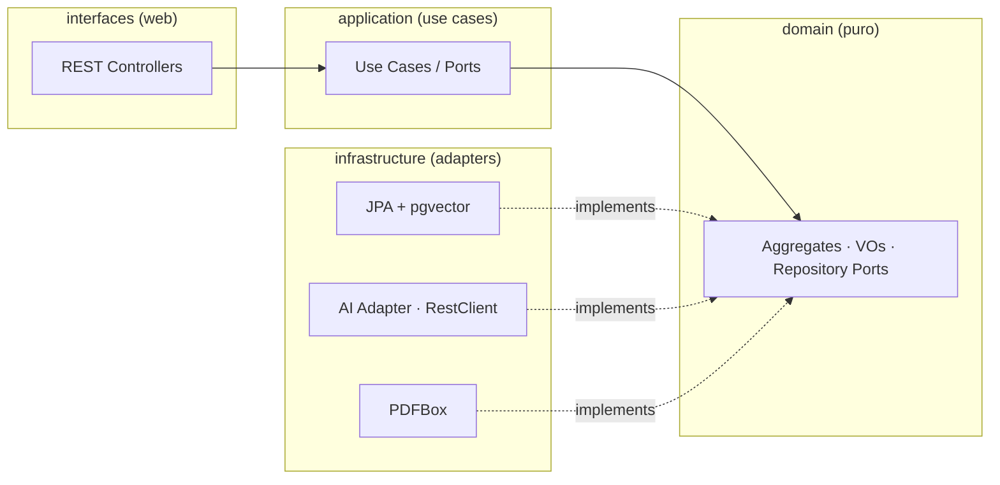

# VagaMatch

> Plataforma que lê o currículo (PDF) da pessoa e ranqueia as vagas do mercado por **compatibilidade real**, usando embeddings e busca vetorial. Construída com foco em **Clean Architecture, DDD e testes**.


---

## O que faz

1. A pessoa cria conta e **sobe o currículo em PDF**.
2. O sistema extrai o texto (PDFBox) e usa um LLM para **estruturar o perfil** (skills, stack, senioridade, preferências).
3. Um worker **ingere vagas** de fontes públicas (Greenhouse, Remotive, ...) e gera **embeddings**.
4. O **matching** cruza o perfil com as vagas via **similaridade de cosseno (pgvector)** + filtros de negócio, e explica *por que* cada vaga combina.

## Arquitetura (Clean Architecture + DDD)

Dependências apontam **para dentro**. O domínio é Java puro, sem framework — garantido por testes de **ArchUnit**.



**Bounded contexts:** `identity` (auth JWT) · `candidates` (currículo → perfil) · `jobs` (catálogo + ingestão) · `matching` (score + explicação).

## Stack

| Camada | Tecnologias |
|--------|-------------|
| Backend | Java 21, Spring Boot 4, Spring Web, Spring Data JPA, Spring Security (JWT) |
| Dados | PostgreSQL + **pgvector**, Flyway (migrations) |
| IA | Adapter próprio (hexagonal) sobre a API de embeddings/LLM |
| Mapeamento | MapStruct, Lombok |
| Testes | JUnit 5, Mockito, AssertJ, **Testcontainers**, REST-assured, **ArchUnit** |
| Frontend | Angular 19 (signals, standalone), Angular Material, Playwright (e2e) |
| DevEx | Docker Compose, GitHub Actions (CI) |

## Como rodar

```bash
# 1. Banco (Postgres + pgvector)
docker compose up -d

# 2. Backend
cd backend
mvn spring-boot:run

# 3. Frontend
cd frontend
npm install && npm start
```

## Testes

```bash
cd backend
mvn test          # unitários + integração (Testcontainers) + arquitetura (ArchUnit)
```

## Roadmap

- [x] Fundação: Clean Architecture, domínio de `jobs`, migrations, ArchUnit
- [x] Adapter de IA (embeddings) via RestClient — mock (sem custo) + OpenAI, selecionável por config
- [x] Persistência com pgvector (`JobRepository` via JdbcClient, testado com Testcontainers)
- [x] Ingestão de vagas: fonte Remotive + `IngestJobsUseCase` (testado com fonte fake)
- [ ] Ingestão: fonte Greenhouse + agendamento `@Scheduled`
- [x] Contexto `matching`: busca por similaridade (pgvector) + filtros, testado com Testcontainers
- [x] Contexto `candidates`: upload de PDF → perfil (PDFBox + embedding)
- [x] API REST: `POST /api/match` (currículo → vagas) e `POST /api/admin/ingest`
- [x] Auth JWT (`identity`): registro/login, BCrypt, filtro JWT, RBAC (USER/ADMIN), seeder de admin
- [x] Endpoints `POST /api/auth/register|login`, `GET /api/me`, RBAC em `/api/admin/**`
- [x] Frontend Angular 19: landing, login/registro, painel do usuário, painel admin
- [x] Auth no front: signals, interceptor JWT, guards de rota (`authGuard`, `adminGuard`), CORS no backend
- [ ] Explicação do match por LLM (ChatProvider)
- [ ] OpenAPI/Swagger, E2E (Playwright) e CI

---

Feito por [Iury Gabriel](https://github.com/iury-gabriel) · [portfólio](https://portfolio-iury-gabriel.vercel.app)
